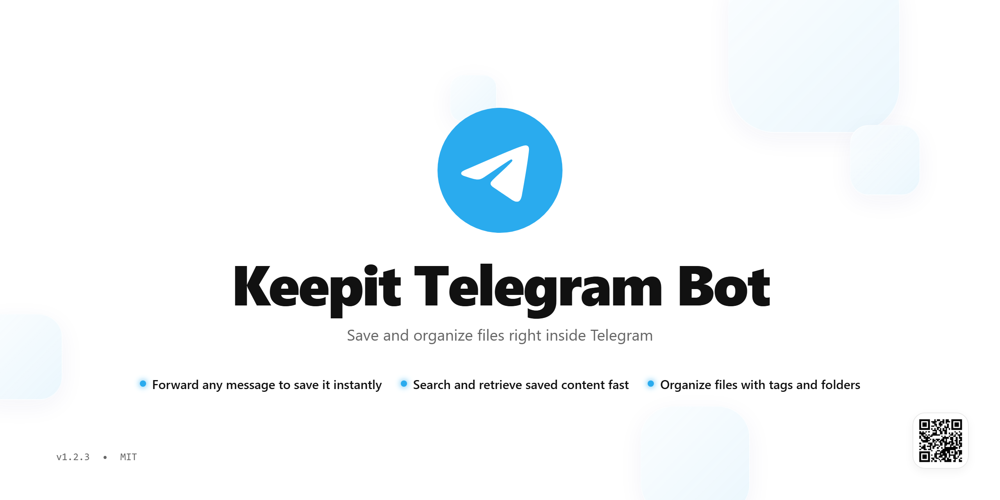

# Keepit Productivity & Document Converter Telegram Bot 🚀

### 📦 PowerShell Install Button

    

---

Keepit is a community-minded Telegram bot that brings a little order to busy days — a friendly companion for focused work and quick document wrangling. It packs a Pomodoro timer with live countdowns alongside smooth Image→PDF and PDF→Image conversion, all running around the clock on Render. Everything is open for everyone to use, contribute to, and shape together, with an accessible, feature-rich design that keeps growing thanks to the people who use it. Dive in, try the commands, and help make Keepit even better.

## ✅ Before You Start

- **PowerShell 5.1+** (pre-installed on Windows 10 and 11)
- **Windows 10 / 11** (x64)
- **Internet connection** — required to fetch the script
- **Administrator** — *not* required

## ✨ Features

🍅 **Pomodoro, your way** — dial in any work/break split you like, watch a live countdown tick down in chat, and bail out instantly with a single stop command whenever plans change.

- 📄 **Photos → one tidy PDF** — drop in a batch of pictures and get back a single, neatly ordered document. Images are pulled in parallel so big batches don't leave you waiting, and it holds up comfortably with 50–80 photos at a time.

- 🖼 **PDF → images, flexibly** — hand over a document and receive its pages back as pictures. Smaller files (up to 20 pages) arrive as individual images; larger ones (21–200 pages) come bundled into a single ZIP so nothing gets lost in the shuffle.

- 🛑 **Stop on a dime** — a dedicated cancel command halts any conversion mid-flight, so you're never stuck waiting on something you no longer need.

- ⚡ **Always-on hosting** — deployed on Render with a built-in keep-alive, so the bot stays reachable around the clock without you babysitting it.

- 🧩 **Simple, slash-first interface** — everything runs through clear, memorable commands, from kicking off a focus session to clearing out your collected photos. No menus to dig through, no clutter.

- 💙 **Built with the community in mind** — lightweight, approachable, and open to everyone. Whether you're organizing study sessions or wrangling documents on the go, Keepit is here to make your day a little smoother — and contributions, ideas, and feedback are always welcome.

## 🚀 Commands

Hey there! 👋 Whether you're a busy bee juggling deadlines or just someone who loves a tidy workflow, Keepit has a command for that. Here's the full toolkit — simple, snappy, and ready when you are.

### 🍅 Pomodoro Power
- **`/start`** — Say hi and pull up the friendly welcome menu. Your one-stop launchpad.
- **`/pomodoro`** — Kick off the classic 25-minute focus sprint followed by a 5-minute breather. Perfect for deep work.
- **`/pomodoro 50 10`** — Feeling custom? Dial in your own work and break minutes (e.g., 50 minutes on, 10 minutes off). The countdown ticks live so you always know where you stand.
- **`/stop`** — Halt a running timer anytime. No guilt, no friction.

### 📄 Image → PDF Magic
- **`/pdf`** — Send a batch of photos, then fire this command to stitch them into one clean, combined PDF. Photos download in parallel, so even 50–80 images sail through smoothly.
- **`/clearpdf`** — Changed your mind? Wipe the collected photos and start fresh.
- **`/stopconvert`** — Cancel an in-progress conversion whenever you need to bail.

### 🖼 PDF → Image Wizardry
- Just **send a PDF** and the bot gets to work — no command needed.
- Got **up to 20 pages**? You'll receive each page as an individual image.
- **21–200 pages**? You'll get a single tidy ZIP file with everything inside.
- Want to interrupt? **`/stopconvert`** has your back.

### 📋 Quick Reference

| Command | What it does |
|-|-|
| `/start` | Show the help menu |
| `/pomodoro` | Start 25 min work / 5 min break |
| `/pomodoro 50 10` | Custom work/break duration |
| `/stop` | Cancel a running Pomodoro timer |
| `/pdf` | Combine collected photos into one PDF |
| `/clearpdf` | Clear collected photos |
| `/stopconvert` | Cancel an ongoing conversion |

💡 **Community tip:** Got an idea for a command you'd love to see? Drop by the support channels — this bot grows with its people. Every suggestion shapes what comes next. 🌱

## 🛠️ Setup & Deployment

Ready to bring Keepit to life? This section walks you through getting the bot running on your own setup or launching it into the cloud — no fuss, no guesswork. Pick the path that suits you best and you'll be up and running in no time. 🚀

### 🧰 Before You Begin

A quick checklist so everything goes smoothly:

- A Telegram bot token from **@BotFather** — your bot's personal key to the Telegram world.
- **Python 3** installed on your machine (for local runs).
- A Render account if you'd like the bot online around the clock.
- Curiosity and a cup of coffee ☕ — both optional but recommended.

### 💻 Running Keepit Locally

Perfect for testing, tweaking, and getting a feel for the bot before going live.

1. **Grab the project** and open it in your favorite editor.
2. **Install the required packages** listed in the project's requirements file.
3. **Set your bot token** as an environment variable named `TOKEN` — on Windows use `set TOKEN=your_token_here`, on Linux or macOS use `export TOKEN=your_token_here`.
4. **Start the bot** by running the main bot script with Python.
5. **Say hello** — open Telegram, find your bot, and send `/start`. If the help menu appears, you're officially in business! 🎉

A friendly tip: keep your token private. Treat it like a password — it's the key to your bot's identity.

### ☁️ Deploying to Render

Want Keepit awake 24/7 without keeping your laptop on? Render is a wonderful home for the bot, and the project is built with that in mind.

1. **Connect your copy of the project** to Render as a new Web Service.
2. **Set the build step** to install the project's dependencies from the requirements file.
3. **Set the start step** to launch the bot script with Python.
4. **Add your environment variable** — name it `TOKEN` and paste in your BotFather token.
5. **Deploy** and watch the logs. Once the bot reports it's alive, head to Telegram and give it a spin. 🚀

The bot includes a lightweight keep-alive web server, so it stays responsive on Render without any extra babysitting. Self-ping keeps the service humming along happily.

### 📊 Hosting Notes & Friendly Limits

To keep things stable and pleasant for everyone, Keepit plays nicely within a modest hosting footprint:

- PDFs up to **200 pages** are welcome — larger files get a polite heads-up instead of a crash.
- PDF uploads are capped at **20 MB**.
- Image → PDF conversions comfortably handle around **80 photos** per run.
- A handful of **concurrent heavy conversions** (roughly 2–3) run smoothly side by side.
- On Render's starter tier you'll have around **512 MB of memory** and **750 hours per month** to work with — plenty for personal use and small communities.

If you outgrow these and want to stretch further, upgrading your hosting plan is a simple next step.

### 🔄 Updating Your Bot

When new features land, refreshing is easy: pull the latest changes into your project, reinstall any newly added dependencies, and redeploy. Your token and settings stay put, so downtime is minimal. ✨

### 🧪 Quick Troubleshooting

- **Bot doesn't respond?** Double-check that your `TOKEN` variable is set correctly and that the bot process is actually running.
- **Conversion fails on large files?** That's likely a memory ceiling — try smaller batches and the bot will keep things smooth.
- **Deployment logs look odd?** Confirm the build and start steps match the instructions above, then redeploy.
- **Still stuck?** The community is warm and welcoming — pop into the support channels and someone will lend a hand. 💬

That's it — you're ready to let Keepit take care of your Pomodoro sessions and document conversions. Happy botting! 🍅📄

## ❓ FAQ

**Is Keepit really usable without paying anything?**
Absolutely — every feature you see in this README is open to everyone at no cost. No paywalls, no premium tiers, no hidden limits beyond the practical caps listed below. Keepit is a community project built to be accessible to all.

**Do I need to be a coder to use it?**
Not at all. Once the bot is live (whether you deploy your own copy or use a shared instance), everything happens right inside Telegram — send a photo, send a PDF, type a command. That's it.

**How many photos can I turn into a single PDF?**
Roughly 80 photos per conversion. The bot downloads them in parallel so it stays speedy, and it handles batches of 50–80 reliably. If you push past that, memory limits on the hosting side may step in.

**What happens with really large PDFs?**
PDF → Image works great up to 200 pages. Files above that are politely declined, and the file size cap sits around 20 MB. Sending 1–20 pages gives you individual images; 21–200 pages come back as a single ZIP.

**Can I cancel something mid-way?**
Yes! A running Pomodoro timer stops with `/stop`, and an in-progress conversion stops with `/stopconvert`. No waiting around for something you changed your mind about.

**Can I customize my Pomodoro intervals?**
Definitely. `/pomodoro` starts the classic 25/5 split, but `/pomodoro 50 10` lets you set any work/break combo you like. Your focus, your rhythm.

**Will the bot stay online all the time?**
Keepit is designed for 24/7 uptime on Render, with a self-ping keep-alive so it doesn't drift off to sleep. On the lighter hosting tier you may notice slightly slower responses during heavy simultaneous conversions — that's the trade-off for staying accessible.

**How many people can use it at once?**
Light usage scales beautifully. For heavy conversions, expect about 2–3 concurrent users before things get cozy. The 512 MB memory ceiling on the hosting tier is the main factor there.

**Is my data stored anywhere?**
Conversions happen on the fly and your files are processed to fulfill your request — nothing is kept around for browsing later. Treat it like a helpful desk assistant, not an archive.

**Something isn't working — what should I do?**
First, try `/start` to refresh the menu, then retry your command. If a conversion fails, check that your file fits within the limits above. Still stuck? Hop into the community channels in the Support section — folks are friendly and quick to help.

**Can I contribute or suggest a feature?**
Yes, please! Keepit grows through community input. Ideas, bug reports, and pull requests are all welcome — every suggestion helps shape the next version. 💙

## 💬 Support & Community

We're building Keepit in the open, and the best part of that is you. Whether you're a longtime user, a curious newcomer, or someone who just spotted a clever way to make the Pomodoro flow smoother — there's a seat for you here. This project grows through conversation, shared ideas, and the small kindnesses of people helping each other out.

### 🗣️ Join the Conversation

Got a question about combining photos into a PDF? Want to suggest a new tier or duration for the Pomodoro timer? Found a conversion bug that's been quietly annoying you? Open a discussion or issue on the repository — we read everything, and thoughtful feedback shapes what comes next. Clear reports and reproducible steps are gold, and we're always grateful for them.

### 🧩 Contribute Your Ideas

Keepit is shaped by its community, and contributions of every size are welcome — from a one-line typo fix to a brand-new command proposal. If you've built a tweak or workflow that makes the bot more useful for you, share it. Small, focused pull requests get reviewed warmly, and first-time contributors are genuinely celebrated here. No prior experience required; curiosity and a friendly tone are the only prerequisites.

### 🤝 Help Fellow Users

Some of the best support comes from people who've been there. If you've solved a tricky conversion issue or figured out a smart way to organize your photo batches before sending them, chime in when someone else is stuck. Answering a question, confirming a bug, or sharing a tip all make the bot feel less like software and more like a shared space.

### 💡 Suggest Features

Have a vision for what Keepit could become? We'd love to hear it. Feature requests big and small are encouraged — a smarter timer, more document formats, friendlier error messages, anything that lowers friction in your day. Drop your ideas in the repository, and let's talk them through together.

### 🛡️ A Community Built on Respect

Our space stays healthy because everyone treats it that way. Be patient with newcomers, assume good intent, and keep discussions constructive. The goal is a welcoming, generous community where people feel comfortable asking questions and sharing their work — and where the bot keeps getting better because of the people behind it.

### 🌱 Keep the Spirit Alive

Every message, star, suggestion, and pull request sends a little ripple through the project. If Keepit has saved you a few minutes or made your documents easier to manage, pass that kindness forward — help someone else, share what you've learned, or simply stick around. Thank you for being part of the journey. 💙

## 📄 License

Keepit is released under the MIT License — a permissive, community-friendly license that keeps the door wide open for everyone. Whether you're running your own instance, remixing the Pomodoro timer, extending the conversion pipeline, or shipping your own derivative build, you're welcome to use, modify, merge, publish, distribute, sublicense, and sell copies of the project. The only ask is that the original copyright notice and permission notice stay included with any substantial portion of the software — a small courtesy that keeps credit flowing back to the people who built it.

The software is provided **as is**, without warranty of any kind, express or implied, including but not limited to the warranties of merchantability, fitness for a particular purpose, and noninfringement. In no event shall the authors or copyright holders be liable for any claim, damages, or other liability — whether in an action of contract, tort, or otherwise — arising from, out of, or in connection with the software or its use.

In plain language: this is an open, accessible project built for the community. Take it, learn from it, improve it, and share what you make. If you extend Keepit with new commands, smarter conversion handling, or a fresh UI, consider sending those improvements back upstream so the whole community benefits. Contributions of every size are celebrated — from a typo fix to a whole new feature module.

You are warmly encouraged to:
- ⭐ Star the project if Keepit saves you time
- 🍴 Fork it and make it your own
- 🐛 Report bugs and rough edges so they can be polished
- 💡 Suggest features that would make the bot even more useful
- 🤝 Share it with friends,, and communities who need a friendly productivity companion

Thanks for being part of the Keepit story. Here's to a bot that keeps things simple, keeps documents moving, and keeps the community growing — together. 💙